<p align="center">
  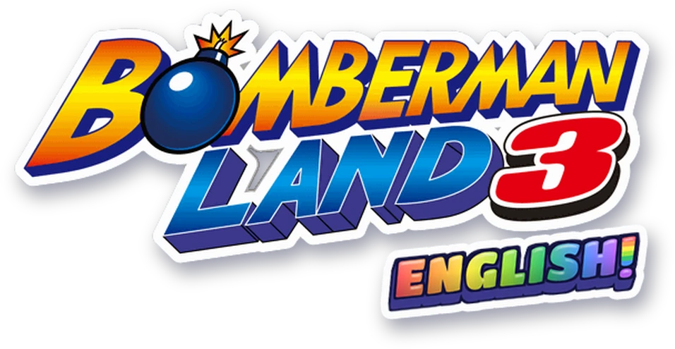
</p>

# 
This is a **free, independent fan patch with zero monetization: it's not for sale, and there are no
donations, tips, Patreon, ads or even a Discord server, bla bla bla.** I made it simply because
this game is very special to me, and it was my dream to play it in a language I understand.

**Bomberman Land 3** (ボンバーマンランド3) came out on the PlayStation 2 in 2005, packed an entire
theme park full of minigames and adventures, and then... never left Japan. Over twenty years later, it finally
speaks English.

The patch DOES NOT include any of the game's files: you need your own legitimate copy of the game,
extracted from your disc. **DO NOT ASK FOR GAME FILES!**

Using it is easy: open the patcher, pick your game's `.bin` file, the translation patch and an
output folder, then click the PATCH! bomb (yes, it explodes) and have fun!
(Step-by-step instructions are [below](#2-how-to-play).)

### 👉 [Download the latest release](../../releases/latest)

<table>
  <tr>
    <td width="33%" align="center" valign="top">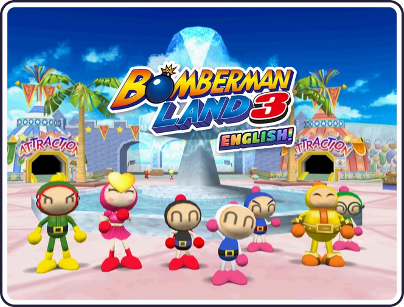<br><sub>BL3 English Patch!</sub></td>
    <td width="33%" align="center" valign="top">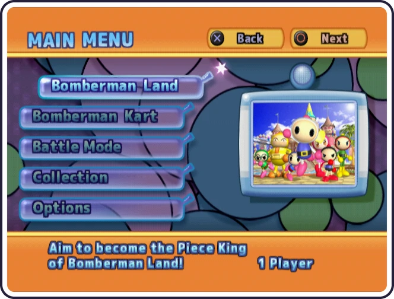<br><sub>Menus</sub></td>
    <td width="33%" align="center" valign="top">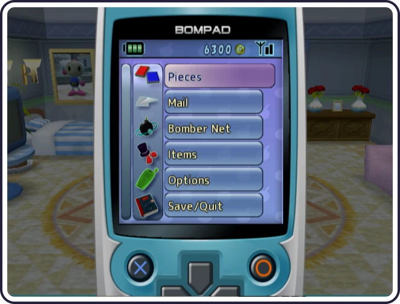<br><sub>Bompad</sub></td>
  </tr>
  <tr>
    <td width="33%" align="center" valign="top">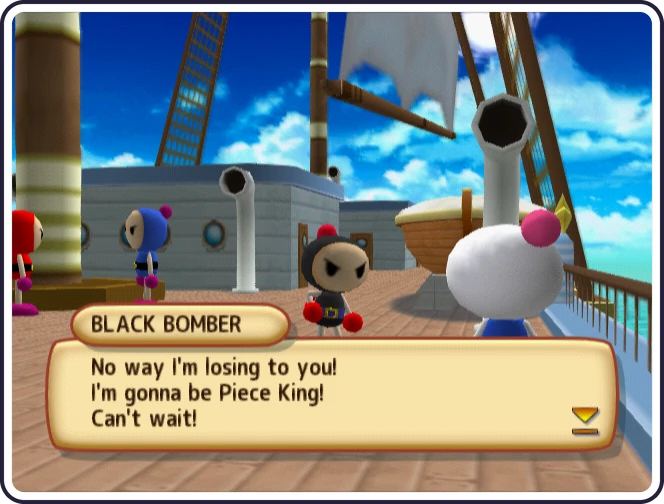<br><sub>Every line of dialogue</sub></td>
    <td width="33%" align="center" valign="top">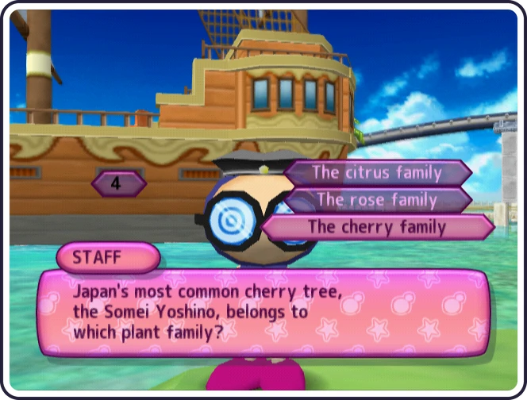<br><sub>Pop quiz! (Hint: it's not the cherry family)</sub></td>
    <td width="33%" align="center" valign="top">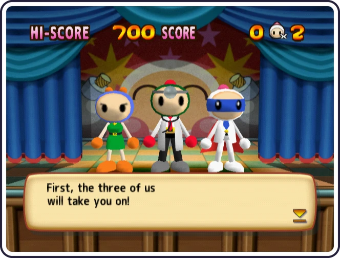<br><sub>Attractions</sub></td>
  </tr>
  <tr>
    <td width="33%" align="center" valign="top">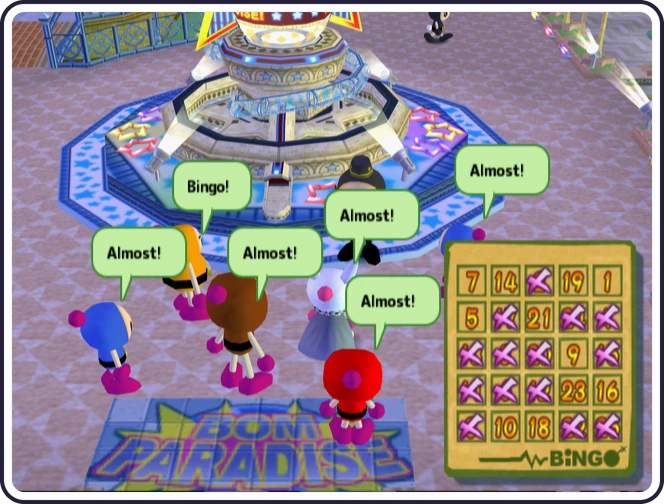<br><sub>One Bingo! and a whole lot of Almost!</sub></td>
    <td width="33%" align="center" valign="top">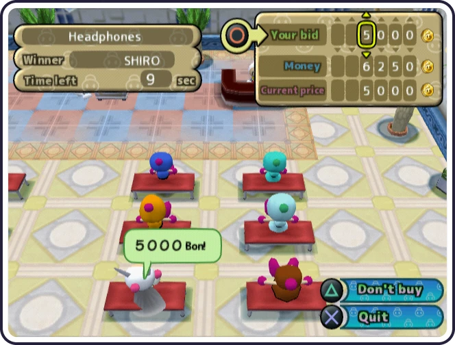<br><sub>Auctions and shops, priced in Bon</sub></td>
    <td width="33%" align="center" valign="top">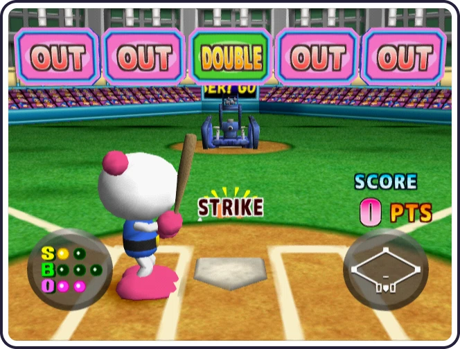<br><sub>Redrawn in-game graphics</sub></td>
  </tr>
  <tr>
    <td width="33%" align="center" valign="top">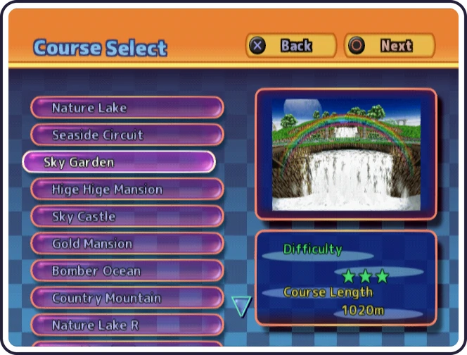<br><sub>Bomberman Kart, fully translated</sub></td>
    <td width="33%" align="center" valign="top">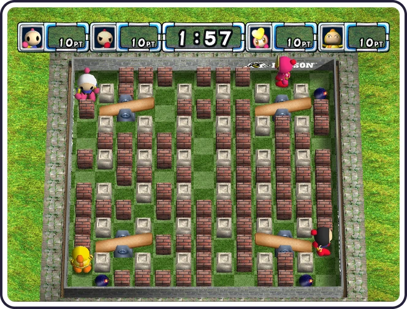<br><sub>Battle Mode, menus and all</sub></td>
    <td width="33%" align="center" valign="top">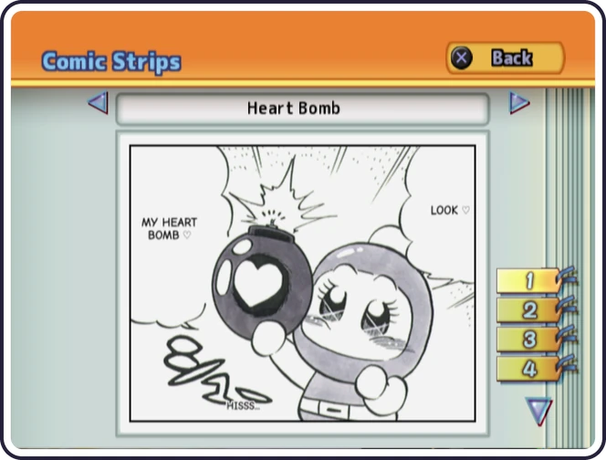<br><sub>Even the comic strips speak English</sub></td>
  </tr>
</table>

## 1. What's translated

Pretty much everything that talks, blinks or has a sign on it:

- every menu and option
- the story, and every single character's lines
- signs, notices, items and gear
- all the attractions, and their rules
- the Capsule Apps, Bomberman Kart and Battle Mode
- the comic strip collection
- the pictures with Japanese text baked in, redrawn in English

Names follow the official English releases wherever there is one: White Bomber, Pink Bomber,
Giant Gold, the whole gang.

## 2. How to play?

**You need:**

1-  **Your own copy of the game**, dumped the Redump way: `Bomberman Land 3 (Japan).bin` + `.cue`.
  No game files are shared here or anywhere in this project, so please don't ask. The bomb is
  watching.
2 - **On Windows:** nothing else. The patcher is a regular `.exe`.
3 - **On macOS or Linux:** [Python 3](https://www.python.org/downloads/), which runs the same patcher.

**Then:**

1. From the [latest release](../../releases/latest), grab `BL3_EN.bl3p` (the patch) and the patcher:
   `BL3_English_Patcher.exe` on Windows, or **Source code (zip)** anywhere else.
2. Open the patcher (on macOS or Linux, unzip and open `patch/BL3_Patcher.pyw`).
3. Pick your `.bin`, then `BL3_EN.bl3p`, then where the English game should go.
4. Click the **PATCH!** bomb. It explodes. That's normal. That's the whole point.
5. Load `Bomberman Land 3 (English).cue` and play!

Your original game file is never touched. It just gets a new English-speaking sibling.

<p align="center">
  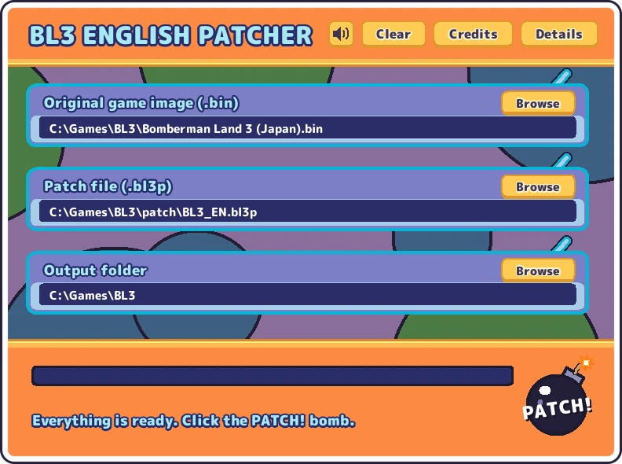
</p>

The patcher checks your game before changing a single byte. Wrong version, or a copy that was
already modified? It politely refuses and nothing happens.

**Windows says it "protected your PC"?** That's because the `.exe` isn't signed (signing costs
money every year, and we spent ours on bombs). Click **More info**, then **Run anyway**. The `.exe`
is built by GitHub straight from the code in this repository, so it's the same patcher as the zip.

<details>
<summary>Team terminal? Click here.</summary>

```
python patch/bl3_apply_patch.py "Bomberman Land 3 (Japan).bin" BL3_EN.bl3p "Bomberman Land 3 (English).bin"
```

</details>

## 3. Questions you might have

**Which copy of the game do I need?**
The Japanese release (`SLPM-62643`), as a Redump `.bin` + `.cue`. Not an `.iso`: the patcher
needs the raw `.bin`, and it checks it's the right game before doing anything.

**Is any of the game included here?**
Nope. The patch only holds the changes, and it checks them against your own copy when you apply it.

**I found a typo, or something still in Japanese!**
Thank you, sharp-eyed bomber. Open an [issue](../../issues) with a screenshot and where it
happened, and it'll get fixed.

## 4. Credits

- **Translation and patch:** [GuiAugusti](https://github.com/GuiAugusti), AI-assisted.
- **Fonts:** M+ Rounded 1c (the patcher and the game's new text), Comic Neue (the comic strips) and
  Titan One (the ENGLISH! logo), all under the [SIL Open Font License](https://openfontlicense.org);
  DejaVu Sans Mono for a few symbols ([its license](https://dejavu-fonts.github.io/License.html)).

<p align="center">
  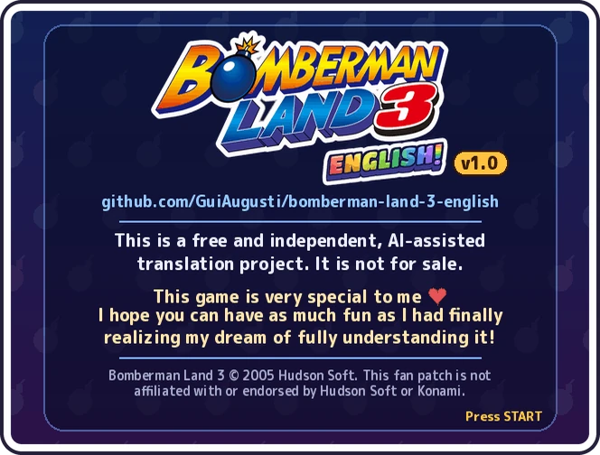<br>
  <sub>The patch's own credits screen, right after the game boots</sub>
</p>

## 5. Legal

This is a free, independent fan project: it's not for sale, and it doesn't take donations. Bomberman Land 3 © 2005 Hudson
Soft. This fan patch is not affiliated with or endorsed by Hudson Soft or Konami.

The patcher's code is under the [MIT License](LICENSE). The font files in `patch/fonts` keep their
own license ([SIL Open Font License](patch/fonts/OFL.txt)).
